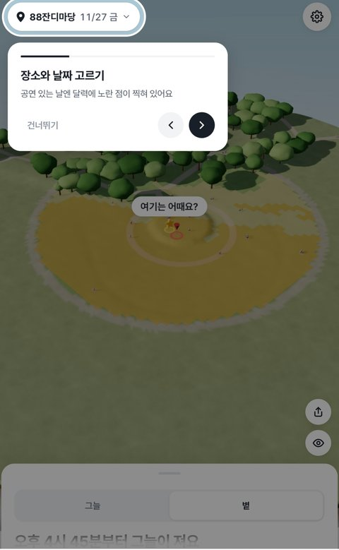
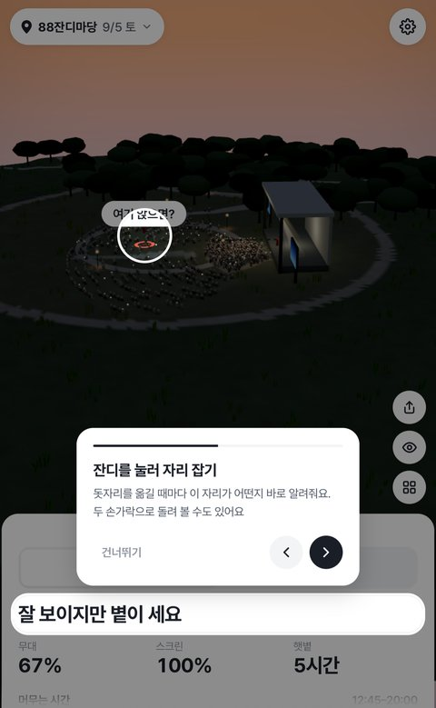
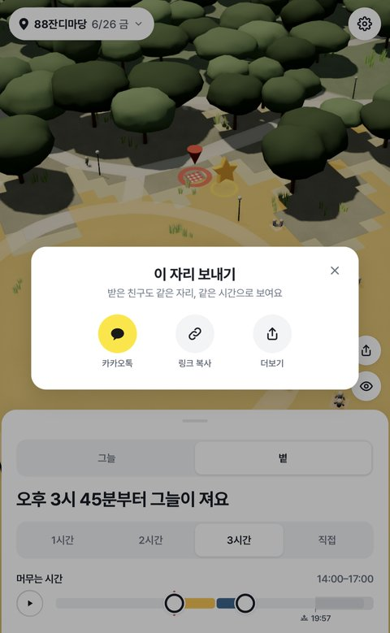
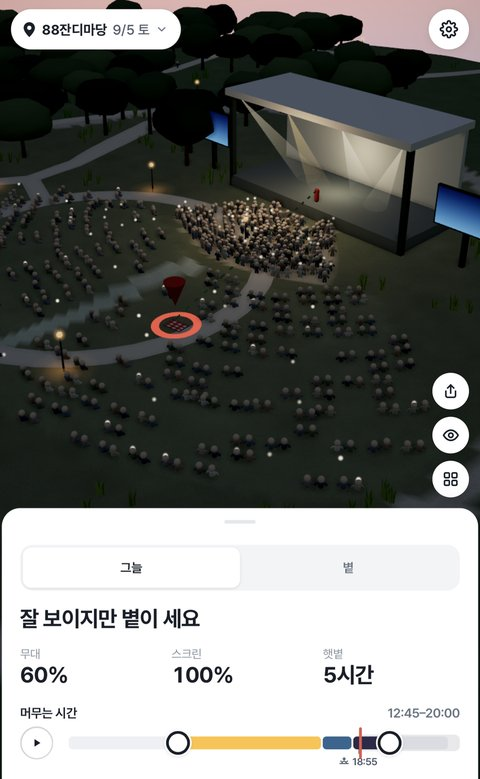
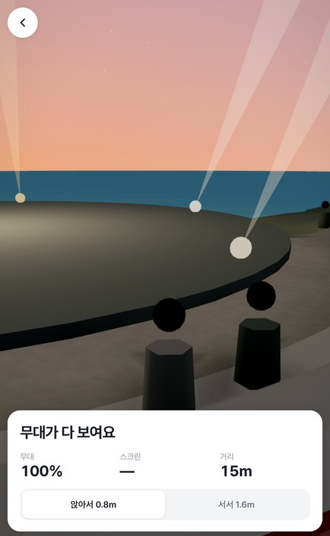
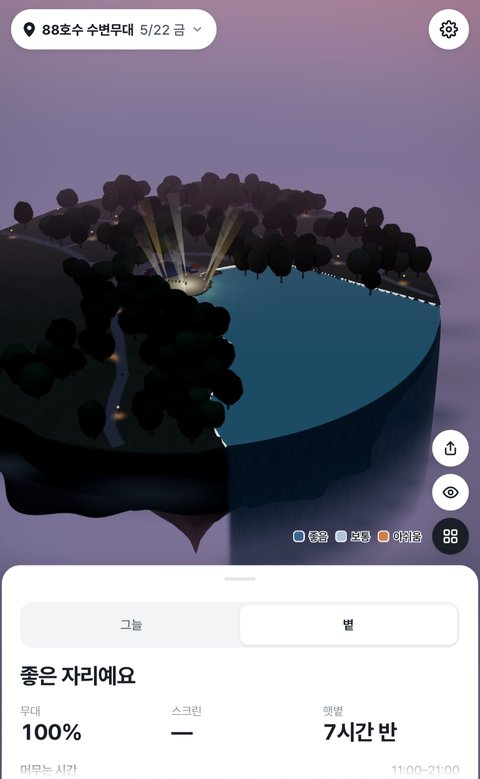
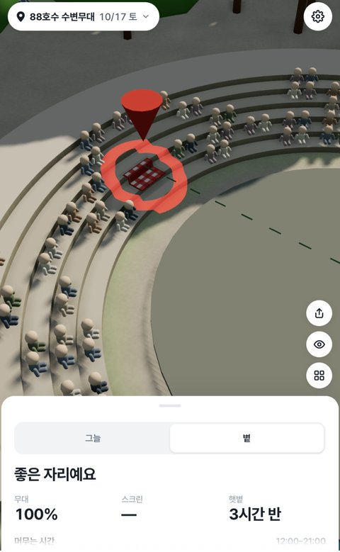
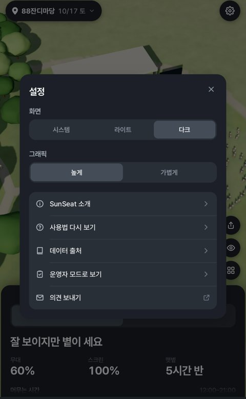
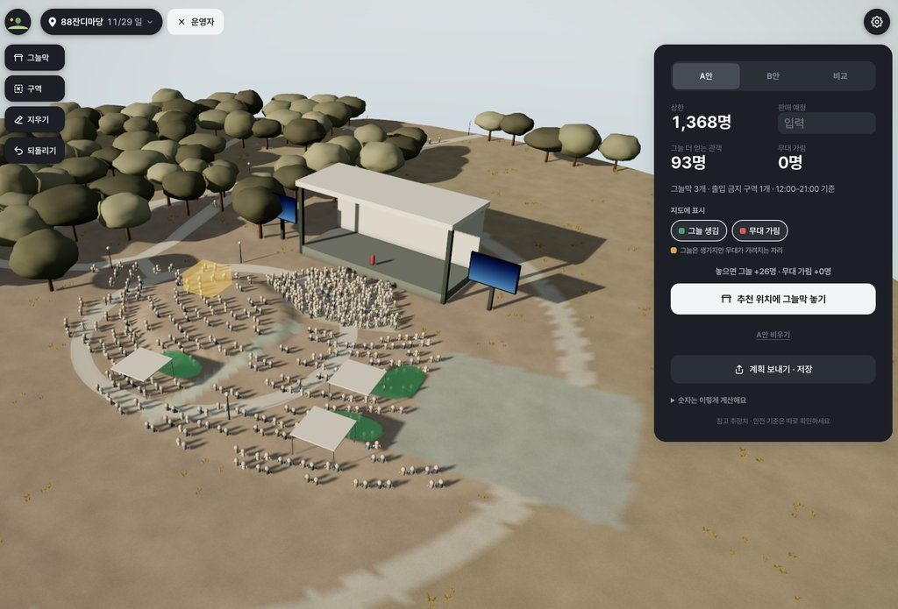
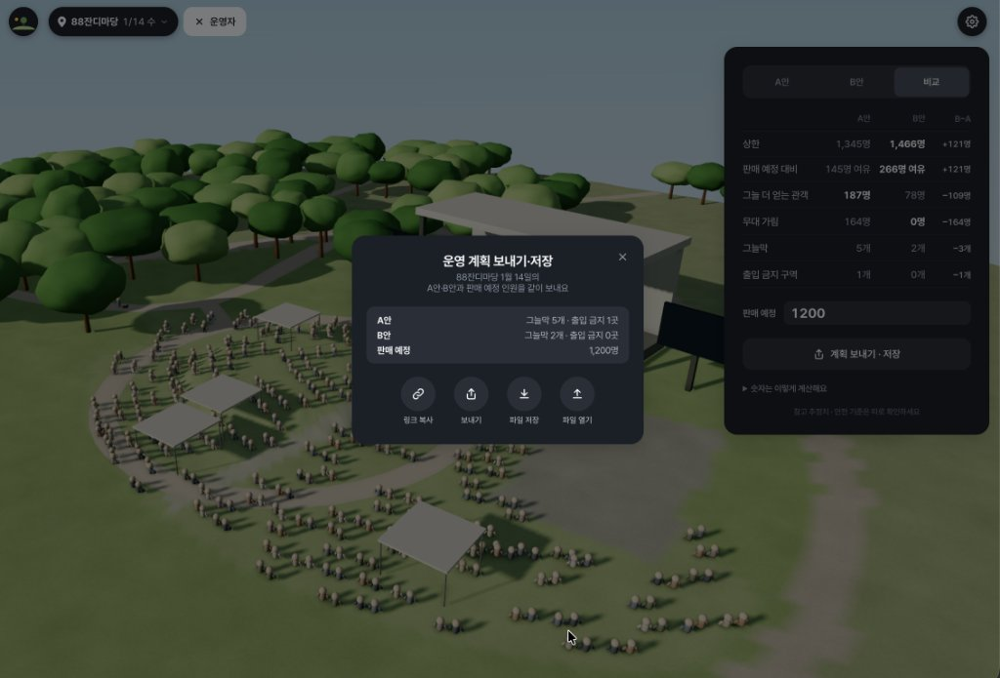

- https://seoyoooooni.github.io/ksponco/

<table>
  <tr>
    <td align="center"> 사용법 안내(2)</td>
    <td align="center"> 사용법 안내(4)</td>
    <td align="center"> 자리 공유 링크</td>
    <td align="center"> 공연날 자리 판정</td>
  </tr>
  <tr>
    <td align="center"> 내 시점</td>
    <td align="center"> 수변무대 3D 전체</td>
    <td align="center"> 계단 객석 자리 판정</td>
    <td align="center"> 설정</td>
  </tr>
</table>

<table>
  <tr>
    <td align="center"> 관리자 화면</td>
    <td align="center"> 관리자 운영 계획 내보내기</td>
  </tr>
</table>
